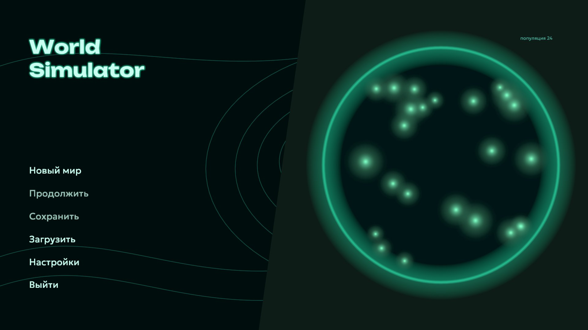
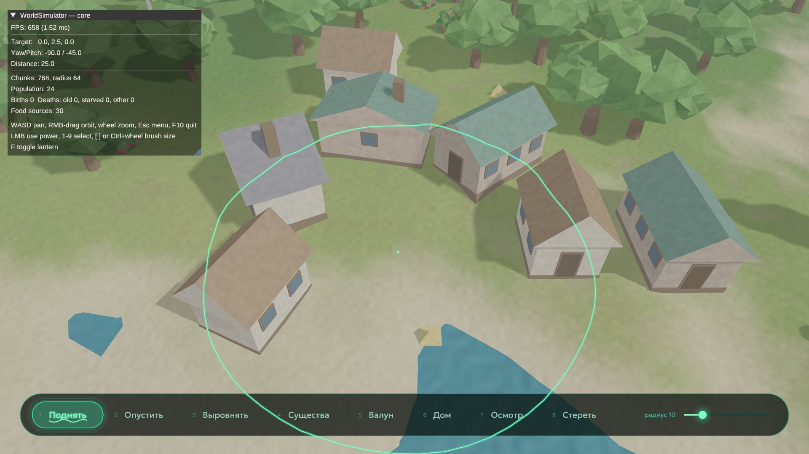
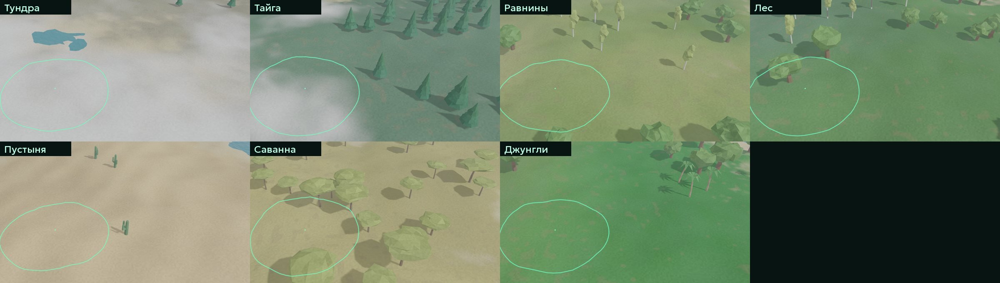
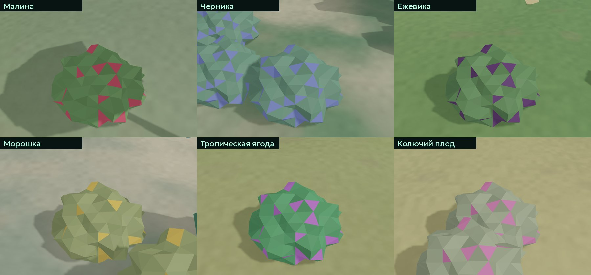
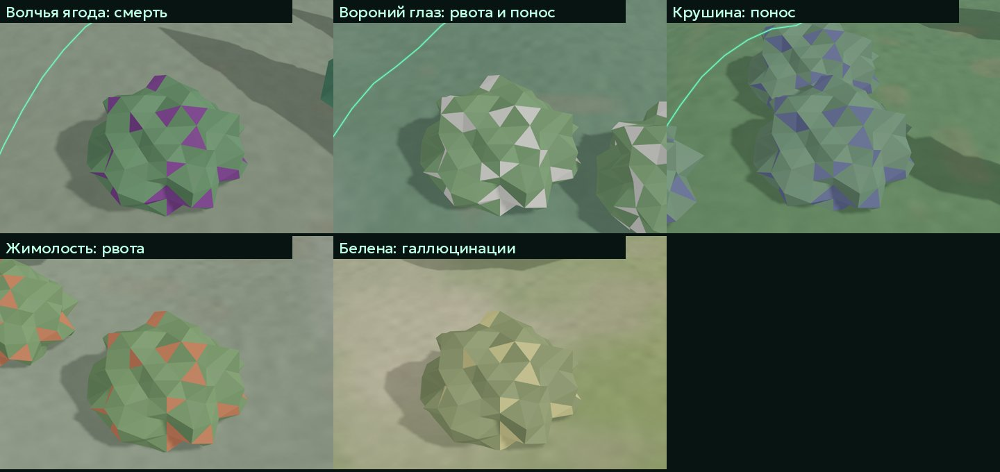

# WorldSimulator

Симулятор мира в духе god-game: **Creatures** (у каждого существа свой геном, простой
нейромозг и потребности) плюс **WorldBox** (песочница: силы бога, ландшафт, хаос).
Вы смотрите на мир сверху и лепите его руками: поднимаете горы, роняете валуны,
селите существ, строите дома, а они живут, едят, размножаются, голодают и пугаются.







C++23 · Vulkan 1.4 · GLFW · Dear ImGui · Lua (моды) · miniaudio · CMake + Ninja · Clang.

## Что уже есть

- **Бесконечный ландшафт** из чанков с LOD, вода, дальность прорисовки подстраивается под FPS.
- **Семь биомов** (тундра, тайга, равнины, лес, пустыня, саванна, джунгли) из температуры и влажности; горы остывают
  и белеют сами. У каждого биома свои цвета земли, густота и виды деревьев (дуб, берёза, ель, сосна, акация, кактус, пальма).
- **Ягодные кусты** одиннадцати видов: шесть съедобных и пять с разным действием (смерть, рвота, понос, галлюцинации, рвота с поносом)
  растут пятнами по биомам. Существа запоминают вкус по внешнему виду ягод (подделки под съедобные путают их), после отравления обходят такие
  кусты, а галлюцинирующий мечется и пугает стаю; их можно сажать силой «Кусты» (в модах: тип `bush`, `ctx:bush`).
- **Освещение:** каскадные карты теней от солнца, процедурные материалы, туман, фонарь (F).
- **Существа:** геном из 863 генов (темперамент и веса мозга), нейросеть как модулятор
  поверх utility-ИИ, обучение в течение жизни, голод, усталость, страх, горе, брачные
  отношения, паника в стае, ориентирование на склонах и берегах.
- **Силы бога:** поднять, опустить, выровнять, существа, валун, дом, осмотр, стереть.
- **Физика валунов** на карте высот: удары убивают существ, рушат дома и копают кратеры.
- **Моды на Lua и JSON** в песочнице (сейчас моды добавляют новые силы), см. [mods/README.md](mods/README.md).
- **Звук:** все звуки синтезируются процедурно, музыка и окружение подстраиваются под камеру.
- **Сохранения:** быстрые (F5 / F9), автосохранение, слоты; загруженный мир продолжается
  бит-в-бит так же, как оригинал (проверено тестами).
- Свой **temporal-апскейлер** (джиттер, векторы движения, накопление истории; при 100% это TAA) и **генерация кадров**
  (промежуточные кадры по векторам движения, нужна вертикальная синхронизация). Рядом FSR 1.0 и NIS.
- Интерфейс на русском, настройки графики (MSAA, апскейлер, тени), звука и управления.

## Управление

| Действие | Клавиши |
|---|---|
| Двигать камеру | WASD |
| Вращать камеру | правая кнопка мыши + перетаскивание |
| Приблизить / отдалить | колесо мыши |
| Применить силу | левая кнопка мыши |
| Выбрать силу | 1–9 |
| Размер кисти | `[` `]` или Ctrl + колесо |
| Фонарь | F |
| Быстрое сохранение / загрузка | F5 / F9 |
| Меню | Esc |

## Сборка

Нужны: Vulkan SDK / загрузчик, GLFW 3.4, glm, nlohmann_json, Lua ≥ 5.4 (если системной
нет, соберётся из исходников), Clang, CMake ≥ 4, Ninja. Для Arch:
`pacman -S vulkan-devel glfw glm nlohmann-json lua clang cmake ninja`.

```bash
cmake --preset release
cmake --build --preset release
./build/release/game/worldsim
```

Отладочная сборка: `--preset debug` (она заметно медленнее, для замера FPS берите release).

### Windows (кросс-сборка с Linux)

```bash
cmake --preset release-windows
cmake --build --preset release-windows
cmake --install build/release-windows --prefix dist   # портативная папка
```

Нужны llvm-mingw в `/opt/llvm-mingw` и mingw-sysroot с Vulkan loader, GLFW, glm, nlohmann_json.
Результат запускается под Wine, на настоящей Windows пока не проверялся.

### Тесты

```bash
ctest --test-dir build/debug
```

Отдельные переменные окружения для отладки (`WSIM_SEED`, `WSIM_PERF`, `WSIM_FRAME` и другие)
перечислены в [CLAUDE.md](CLAUDE.md).

## Устройство проекта

Подробное описание каждой подсистемы, принятых решений и того, чего пока нет, лежит
в [CLAUDE.md](CLAUDE.md). Коротко:

```
engine/sim/      симуляция без зависимостей от Vulkan: геном, мозг, мир, ландшафт, физика, сохранения
engine/core/     цикл игры, чанки ландшафта, звуковой директор
engine/renderer/ Vulkan, камера, тени
engine/ui/       меню, настройки, панель сил (ImGui)
engine/audio/    синтезатор и miniaudio
engine/mods/     песочница Lua и загрузка модов
engine/procgen/  процедурные дома и деревья
game/            точка входа
mods/            примеры модов
```

Рендер-каркас (окно, ввод, ImGui, Vulkan) вырос из соседнего проекта Podjezd.

## Планы

Хищники и бой, смена дня и ночи, сон, новые силы (огонь, дождь, катастрофы) и отмена
действий, рубка деревьев, цивилизации.

## Лицензия

[MPL-2.0](LICENSE). Шрифты Unbounded и Geologica распространяются по SIL OFL
(тексты лицензий лежат рядом со шрифтами в `assets/fonts/`).
